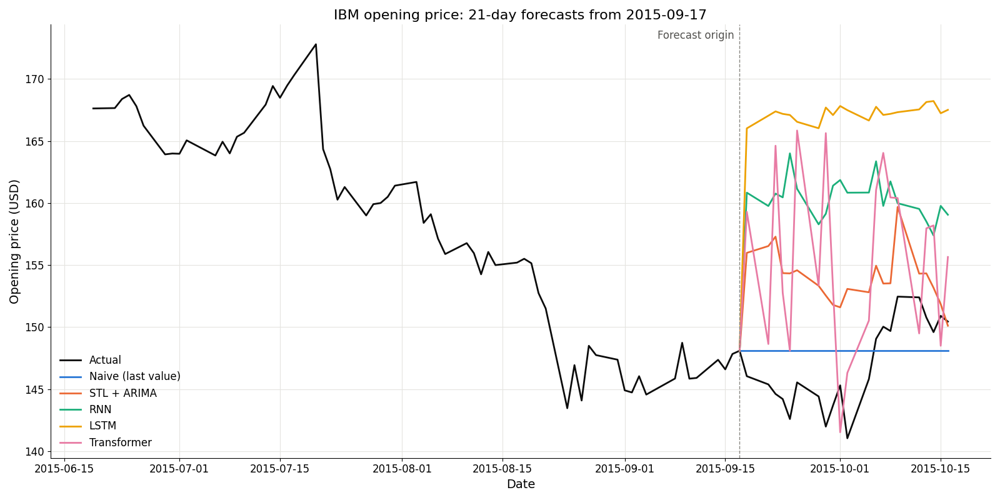

# Stock Market Forecasting

Forecasting IBM daily opening prices (2006–2017) 5 and 21 trading days ahead, comparing a naive baseline and an STL + ARIMA model with recurrent and Transformer neural networks.



*21-day forecasts of all five models for one test window (forecast origin 2015-09-17), with the preceding 63-day input window. The window was chosen so that each model's error on it is close to that model's median over the test windows.*

## Results

| Model | RMSE, 5-day horizon | RMSE, 21-day horizon |
| --- | --- | --- |
| STL + ARIMA | 6.876 | 10.866 |
| Naive (last value) | 2.999 | 5.623 |
| RNN | 5.429 | 15.274 |
| LSTM | 7.800 | 20.583 |
| Transformer | 4.920 | 12.071 |

RMSE in USD, pooled over all forecast steps of 578 rolling test windows (forecast origins from 2015-08-17 to 2017-11-29, the last 20 % of the data). Every model is scored on the same windows. MAE is reported in the notebook.

None of the models beats the naive forecast (repeating the last observed price) on either horizon. Of the neural networks, the Transformer does best.

## Approach

- **Preprocessing.** Forward-filling of missing values, STL decomposition into trend, seasonality and residuals, autocorrelation and return analysis.
- **Features.** Daily high, low, close and volume; technical indicators RSI, Bollinger band width, ATR, 50-day SMA and the distance from it, and on-balance volume; sine/cosine encodings of weekday and month.
- **Naive baseline.** The last observed opening price, repeated over the horizon.
- **Statistical baseline.** STL decomposition with auto-ARIMA models for the trend and residual components; the seasonal component repeats the last observed cycle. The ARIMA orders are chosen once on pre-test data, and STL and ARIMA are refitted on the history up to each test origin.
- **Neural models.** RNN, LSTM and Transformer encoder in PyTorch, trained on 63-day sliding windows with a chronological train/validation/test split. A gap between the splits keeps target windows from overlapping, and scalers are fitted on the training data only.

## Repository structure

| File | Purpose |
| --- | --- |
| `project.ipynb` | Full analysis with results and plots |
| `data_preprocessing.py` | Feature engineering, windowing and splits |
| `model_definitions.py` | RNN, LSTM and Transformer models |
| `training.py` | Training loop and test-set prediction |
| `evaluation.py` | Naive baseline and error metrics |
| `arima_forecasting.py` | STL + ARIMA baseline |
| `visualization.py` | Plotting helpers |
| `data/` | IBM daily price data |
| `models/` | Trained model weights |
| `assets/` | Figure used in this README |

## How to run

```bash
pip install -r requirements.txt notebook
jupyter notebook project.ipynb
```

By default the notebook loads the trained weights from `models/`. Set `TRAIN = True` in the first cell to retrain the neural networks (about 22 minutes on a CPU). For GPU training, install a PyTorch build with CUDA support.

## Context

Course project for *Advanced Data Analysis and Machine Learning*, LUT University. Team: Eetu Knutars, Eetu Peltola and Eero Ryhänen. Released under the [MIT License](LICENSE).

*This README was written with the assistance of generative AI.*
